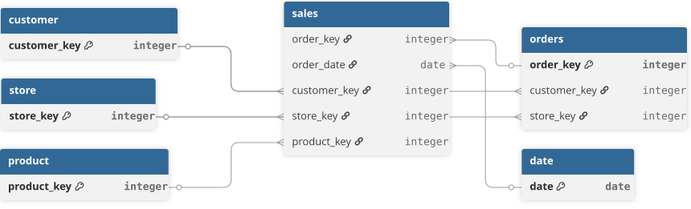

> This document outlines the technical implementation of the project, from raw data ingestion and quality assessment to analytical modeling and SQL optimization.

## Dataset Overview

The dataset represents a fictional global retail business operating across multiple countries and regions. It contains transactional data covering customer orders, product sales, store operations, and currency exchange. The dataset consists of 8 relational tables supporting analysis across the retail business.      

[Download Dataset](https://github.com/sql-bi/Contoso-Data-Generator-V2-data/releases/tag/ready-to-use-data) 

### Tech Stack & Data Architecture

**Tools:** PostgreSQL • DBeaver • Tableau    
**Architecture:** Raw → Clean → Gold → Analysis
```text
Raw Tables
   ↓
Clean Layer → Standardized views (validation, type casting)
   ↓
Gold Layer → Materialized view (customer_summary)
   ↓
Analysis Layer → Views (high_value_customers, at_risk_customers)
```
**Why this setup:** Separates source data from transformed and analytical models, centralizes data standardization, and improves query performance through a reusable, pre-aggregated customer summary.

<br> 



<br>

### Data Load Issue

During the `customer.csv` import, PostgreSQL rejected the batch because the file contained hidden null bytes (`\0`) in 104,753 rows. These characters are not readily visible in spreadsheet editors but are invalid in PostgreSQL's UTF-8 text input.

**Fix:** Removed the null bytes using the `tr` command before reloading the file.

```bash
tr < customer.csv -d '\000' > customer_safe.csv
```
---

### Data Quality Assessment

Following raw data ingestion, quality checks were performed across all tables to identify inconsistencies and issues affecting analytical reliability. The checks identified issues involving missing values, inconsistent formatting, and decimal precision, which were addressed through SQL transformations in the Clean layer.     

**Issues Identified and Resolved:**

| Table        | Column     | Issue                               | Fix Applied                                |
|-------------------|------------------|-----------------------------------------------|-------------------------------------------|
| store             | close_date       | Empty strings                                 | NULLIF()                                  |
|                   | status           | Empty/null values                             | COALESCE(), NULLIF()                      |
| product           | color            | Inconsistent casing                           | INITCAP()                                 |
|                   | cost, price      | Inconsistent decimal precision                | ROUND()                                   |
| customer          | customer_name    | Inconsistent casing, leading/trailing spaces  | INITCAP(), TRIM()                         |
|                   | state            | Leading/trailing spaces                       | TRIM()                                    |
|                   | country          | Null values                                   | COALESCE()                                |
|                   | occupation       | Null values, inconsistent casing              | COALESCE(), INITCAP()                     |
| currency_exchange | exchange_rate    | Inconsistent decimal precision                | ROUND()                                   |
| sales             | unit_price, net_price, unit_cost, exchange_rate   | Inconsistent decimal precision      | ROUND()            |

---

## Analytical Methodology

**1. Customer Summary Table:** Built `customer_summary` as a materialized view, aggregating transaction-level sales data into customer-level metrics to support downstream analysis and improve query performance.

**2. Customer Ranking:** Used `ROW_NUMBER()` to rank customers by revenue and identify the top 10% and top 20% customer groups.

**3. Analytical Views:** Created `high_value_customers` to define the top 20% of customers by revenue and `at_risk_customers` to identify customers within the Declining segment, providing standardized datasets for downstream analysis.

**4. Behavioral Segmentation:**  Applied `PERCENTILE_CONT()` to derive recency and frequency thresholds, classifying high-value customers into Consistent, Stable, Declining, and Inactive segments.

**5. Recency Calculation:** Measured customer recency against the latest recorded transaction date (April 20, 2024).

**6. Query Design:** Used CTEs to organize multi-step transformations and improve query readability and maintainability.

---

**SQL Scripts:**  

- **DDL** [View scripts](sql/01_ddl)    
- **Database Initialization** [View script](sql/db_init.sql)     
- **Data Quality Checks** [View scripts](sql/02_test)     
- **Analytical Queries** [View scripts](sql/03_analytics)